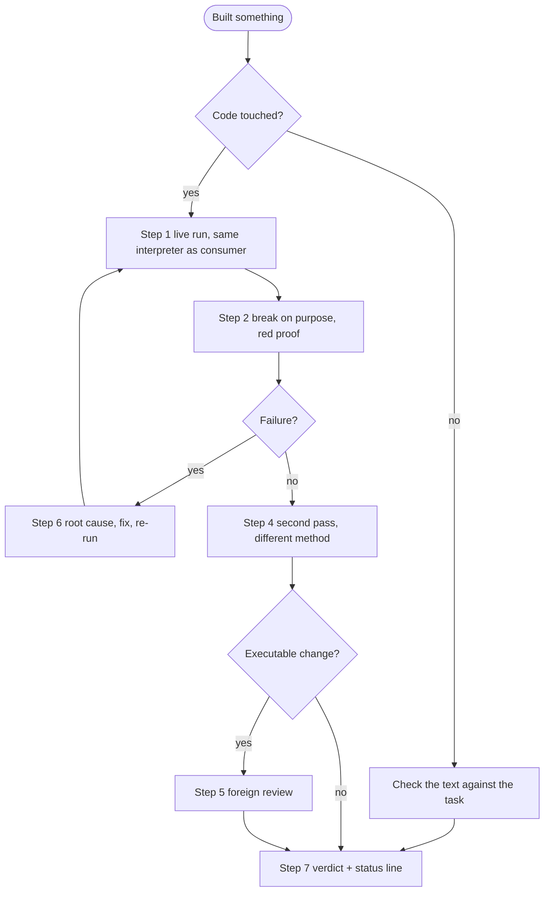

# /prove-build-works: "done" is a claim, and a claim needs evidence

Principle: a green first run proves little. "It works" said from memory is the most common false report. The word "done" is allowed only after a first pass, a break attempt, and a second pass by a DIFFERENT method, each leaving evidence. If nothing was built this session, say so plainly: "nothing to test".

Evidence means the command you ran with its output and exit code, or a quoted line from a file. The words "I checked" are not evidence. Numbers come from an instrument, time from a clock.

## Step 0. Scope: what exactly changed
List the changed artifacts and what each was supposed to do, in the requester's own words, one line per requirement. Search existing notes and prior work first so you do not rebuild or re-test something already settled.
- No code touched: verify the text against the task and stop here.
- Code touched: read the changed places from disk, keep the baseline (hash or ref) and continue.

## Step 0a. About to say "impossible"? Ask the tool first
"Impossible", "no such option", "by design unsupported", or offering the human a manual step instead of automation is a claim too. Walk the cheap ladder in order:
1. `<tool> --help`, `-h`, `help <subcommand>`: the FULL flag list, not what you remember.
2. Subcommands and their own `--help`.
3. The tool's config and environment variables.
4. Documentation of the SAME version.
5. Only then logs, reverse engineering, experiments.

Not walked: the only allowed phrasing is "I did not find how to do it". A silent or crashing `--help` (non-zero exit, traceback, "unknown flag") is a defect of the tool to fix, not an absence of answer.
Mirror trap: a flag found in `--help` proves the flag EXISTS, not that it fits your data. Any flag a verdict relies on must be called once on your data in the same pass.
Expensive evidence does not cancel the cheap check: forty minutes of log forensics once "proved" something one `--help` line disproved in five seconds.

## Step 1. Run it live on real data
- Skill or procedure: execute its steps by hand here.
- Script: run it (dry-run or read-only when there are side effects).
- Routine or hook: trigger it manually and confirm it actually fires, not "it should".
- Rule or note: confirm links resolve and frontmatter is valid.
- Use the SAME interpreter or binary the real consumer will use (scheduler, other machine), not whatever is first on PATH. Print the executable path and compare. "PATH resolved a different Python" is a recurring class of false failures.
Theory is not proof. Show real output.

## Step 2. Break it on purpose (negative and edge cases)
- Empty, malformed or oversized input; missing dependency or key.
- Path assumptions: another drive, another user, another machine. Grep for hardcoded absolute paths or usernames in shared code.
- Stale config or an expired token: does the fact come from the LIVE source, not a stale copy?
- Does it degrade with a clear error rather than failing silently or "pretending"?
- A choice or routing change (engine, vendor, model, path): provoke BOTH doors, the wrongly named option and the unnamed default. The default must be what you claim, not a silent first choice.
- Producer and consumer on different cadences: forge the timestamp to span the gap and prove the window stretches; prove missed deliveries accumulate rather than vanish.
- You built a metric, score or ruler: ask it for its MAXIMUM. Write the theoretical range and add a case that exceeds it. A ranking score once reached 1.63 where the mathematical maximum is 1.0 because the same gold item was counted twice, and 78 green tests never saw it. Also ask which KEY the metric uses to identify objects (name collisions are not edge cases).
- A ratio or percentage: write what one row of numerator and one row of denominator physically are. Different units (hook event vs process start vs session) make the ratio lie silently.
- A metric fallback ("the honest meter is silent, use a worse neighbor"): reporting it is fine, ACTING on it (kill, send, write, commit) is a hole.
- Anything judging by pattern (regex, stop-word list, glob, LIKE, string parser): see Step 2c.

## Step 2a. Red proof: every fix is closed by a test shown RED
A test that never failed is fake.
1. Write the check first and show it FAILING on the unfixed code (case name plus non-zero exit).
2. Fix.
3. Show it green.
4. Keep the break case in the test file. Add at least one counter-case that is green from the very start, otherwise the net paints everything red and proves nothing.
Break on a COPY, never on the live file. Use a tool or a script that copies to a temp location, applies a replacement, requires the check to fail, and prints the live file's hash before and after. Exit meanings: red proven; check PASSED on broken code (test is fake); pattern found other than exactly once (the break did not apply, which looks like a guarantee but is not).
- Read the exit code WITHOUT a pipe. `$?` after `| tail` or `| head` belongs to the last command of the pipeline: `cmd | head -1; echo $?` can print 0 for a real 3. Use no pipe, `set -o pipefail`, `${PIPESTATUS[0]}`, or write output to a file and read it after.
- Chaining `test --flagA || test --flagB` does not prove redness: a test that swallows unknown flags silently returns green and `||` never reaches the right call. Require three measurements: a garbage flag must fail (strictness canary), the green run exits 0, the red run exits non-zero. Refusing to start (usage error) is NOT redness.
- Pick an instrument that can see the class. A syntax check is green on a bug that appears only at execution (a union-type annotation valid to the parser but failing at import on an older runtime). Test the instrument on a file you know is broken; if it stays silent, it is the wrong instrument.
- The assertion must look at the quantity the breaker moves. Breaker and assertion must name DIFFERENT numbers, else the case is vacuous. Check internal counters, not substrings of human-readable text; capture stdout when asserting on printed output. Make EACH case go red, not only the file as a whole: the red branch must break the object (swap the filter, engine, loader), not erase the test's failure.
- Guards, gates and probes need a DOUBLE proof: (1) red on deliberately broken input, break case kept; (2) a run in the context where it lives (from the scheduler or cron, reading its output), not from the live session. Missing either half caps the verdict at partial.
- A fail-closed gate gets mutation measurement: disable each protection one at a time and run the suite. A green suite on a mutant means that protection can be deleted unnoticed. Run mutant series with bytecode writing disabled (`PYTHONDONTWRITEBYTECODE=1`) because same-second mutations can reuse stale caches and blame the previous mutant. A mutant must kill exactly ITS check; killing others means it is misnamed or the run is dirty. Finish with a control run on the restored original. Verify the mutation itself actually breaks the protection (`X = [] or [...]` yields a non-empty list).

## Step 2b. The instrument is a claim too
- Population: a guard that sweeps a roster must also be proven on its census. Print "N items scanned" and compare N with the source by eye once; an empty or truncated population gives a green indistinguishable from an honest one.
- Report "cannot judge N of M" every time; coverage under 90% means the instrument is blind.
- A check by file name: a status symbol next to a file name proves nothing until the file is found on disk. Verdict is "not confirmed, searched here", never "file does not exist".
- Substring is not structure: a detector that matches a short word inside another word, a key instead of a value, or the raw command string instead of what it executes will eventually misfire. Parse structure where the verdict switches something off (skip, block, publish, wake a model). Over flat human text where a false hit is visible and cheap, grep is the right tool; do not turn every grep into a parser.
- Time-travel: the check must read what the CONSUMER will see, not what the producer wrote.

## Step 2c. Pattern-based checks: edge table plus a foreign reviewer
When a verdict rests on a regex, stop-word list, glob or string parser, before "done":
1. Edge table of 10-20 rows "input to expected yes/no", with false positives first. Mandatory families: case; unicode dashes and no hyphen at all; a line break inside a word; plural; possessive; a word with a prefix (`founding`, `founder-builder`); a legitimate homonym.
2. Send the pattern to a model from another vendor: "which inputs will my pattern miss, and which will it wrongly flag?"
Prefer a miss over a false alarm: a miss leaves a defect lying around, a false alarm makes people "fix" correct text. Report "edge inputs N, misses M, second opinion: <who or why not>".

## Step 3. Visibility layer: can anyone see that it worked?
The commonest silent bug is not in the core but in invisible results.
- Logs, counters or output exist and are readable by the consumer.
- Silence is distinguishable from success (a zero must differ from "never ran").
- Check from the outside of the wire: look at the result the way a stranger or downstream consumer sees it.
- The object you write into is alive, not abandoned or archived.
- Scoring judges the object, not a bag of words; a join key is actually populated; an in-flight item has an owner who returns it if its holder dies; a corpus has a query that actually finds it (prove with one real query).
- Escape hatches: a loop with no external pressure (item cap, time cap, token cap, human gate) is not allowed. An autonomous loop WITHOUT an iteration cap is not partial, it is FAIL.
- Do not add a second killer for an object that already has an owner.
- Scale: does cost grow with VOLUME or with CHANGES? Prefer the second.

## Step 3a. Test, doc, counter
Every living part gets, in the same pass: a test, a docstring-style passport in the file (input, output, who calls it, what breaks), and a usage counter (timestamp, actor, event, outcome). Measure use, not calls. A hook or door that is not wired into the config is not built: prove it by calling it through the real entry point.

## Step 4. Second pass: "done" is a claim, check it twice
Steps 1-3 green is only the FIRST pass. The second must differ from the first or it repeats the same blindness.
1. Start from the REQUIREMENTS, not the code. List what was asked (in the requester's words, not your paraphrase) and put evidence against EACH item: live output, counter, file line. An item without evidence is not done, even if you remember doing it. This catches "done 2/3".
2. Use a DIFFERENT method. Repeating the same command is not a second pass. Change angle: read the changed place from disk instead of from memory; ask the CONSUMER instead of the producer; count with an instrument what you first judged by eye; view the artifact from the other end of the wire.
3. Exactly the places you changed: is it on disk? did it reach the consumer? is the OLD behavior gone (not coexisting with the new)?
4. Your own instrument is also an object of the second pass. A first count once reported 475 cases because harness boilerplate got into the sample; the honest number was 57.
5. Name what you did NOT check. A line "checked: ... , not checked: ... (why)" is mandatory. "I did not touch this half" is a normal result; silence is a false "done".
6. Critical work gets a THIRD pass by foreign eyes: money, irreversible actions, fleet-wide rollout, outbound messages to third parties, publication, secrets, canon edits. Use a panel of other-vendor models, another machine or another tool.
Until the second pass is shown, the words "all works", "done", "fixed" and the green check mark are banned. Allowed: "first run green, going to recheck".

## Step 5. Foreign review (when something executable changed)
Send the CODE OF THE FIX, not the original task, plus a list of "what I declared closed", and ask the reviewer to break THESE fixes. Own green acceptance is not evidence. Use reviewers of other model families, in parallel; your own model's subagents are extra eyes but do not count as independent. Findings are hypotheses: verify each against the primary source, report accepted and refuted. Two or more reviewers naming the same defect independently means fix without debate. A reviewer who approves must have run at least one check themselves. Notes-only changes may skip this consciously, with the skip logged. Reviewer unavailable after all doors tried: the verdict caps at partial, never pass.

## Step 6. Root cause, fix, re-run
Any failure in Steps 1-3 is a defect of THIS task's artifact: dig to the root, fix the class, go back to Step 1 and re-run until clean. Do not patch the symptom. Safety-critical parts (locks, sync, auth, scheduler, idempotency): read the implementation before changing it and add a mini-test.
- Name a defect class by the SUBJECT of repair, not by channel, exit code or alert text. Test: "if I fix this, does the class close forever?" If tomorrow another subject arrives, it is a queue wearing a defect's name.
- Third dated occurrence of one class, or data loss, security, money, or a lying instrument: do not dig inside this skill; open a separate root-cause session (five whys) with the dated rows.
- Before claiming "we had no door for this", check whether the named door ever worked once: open its counter and look for one `ok` row. All `busy`, `skip`, `blocked` means the door is locked shut and the repair subject is the lock. "We did it by hand" in the object's history is the strongest sign of a locked door.
- Bug that will not yield quickly: stop digging when any of these hits: 2 or more failed attempts; root spans more than 2 files or touches adjacent systems; reproduction over 10 minutes; context over 70% used. Move to a separate session with a seed prompt (what we did, what we reached, what was rejected and why, acceptance criterion, non-goals) and mark the artifact partial.

## Step 7. Verdict with evidence
Short table: what was checked, how (live output), pass or partial or fail. Then one final line:
- PASS: ran it, broke it, visible, second pass shown, foreign review obtained when required. Only this means "done".
- PARTIAL: works but a yellow flag remains; name what is left.
- FAIL: does not work or is not visible; root cause and what you are fixing.

Verdict ceilings (partial at best even if everything else is green): second opinion skipped; no test, doc or counter; autonomous loop with unproven backpressure; fix not rolled out to every consumer; second pass not shown as a line ("rechecked by X, found / did not find Y").

Flattering conclusions get a stronger check, not a weaker one. If the conclusion is convenient (closes the work, blames someone else, puts us ahead, allows skipping an unpleasant task, confirms prior belief), require ONE extra independent evidence item.

Final status line, mandatory form:
`verified: <what, with command or file evidence> | not verified: <what, and why> | verdict: PASS/PARTIAL/FAIL`

Delivery is not effect. If the work promised an effect (fewer tokens, more replies, faster, cheaper), add a line: `measure on: <date in 30 days> | metric | instrument | baseline | control`; otherwise `measure: not applicable`. If the fix is a class that strangers could reproduce without your internals, offer it to the public (a short write-up or an upstream thread) in the same pass.

## Decision tree

<!--kit-footer-->

---

**Like this skill?** It is part of [second-brain-starter-kit](https://github.com/tonydzi/second-brain-starter-kit): the second brain we built for ourselves and run every day at Palo Alto AI Research Lab. Install the whole set with `npx skills add tonydzi/second-brain-starter-kit`. Everything is open source and free, so take what you need.

Flagships worth a look on their own: [secondop-panel](https://github.com/tonydzi/secondop-panel) (a second opinion from a panel of external models), [claude-memory-tidy](https://github.com/tonydzi/claude-memory-tidy) (stop your agent's memory from rotting), [telegram-mcp-kit](https://github.com/tonydzi/telegram-mcp-kit) (your own Telegram over MCP in about 15 minutes).

Author: **Anton Dziatkovskii**, Palo Alto AI Research Lab. Telegram [@tonydzi](https://t.me/tonydzi) - WhatsApp [+1 341 222 9178](https://wa.me/13412229178) - X [@Tony_Stef_](https://x.com/Tony_Stef_)

**Engineers: want to test-drive this setup?** Message me. I hand out free starter seeds to engineers who test and report back, and custom skill requests are welcome.
